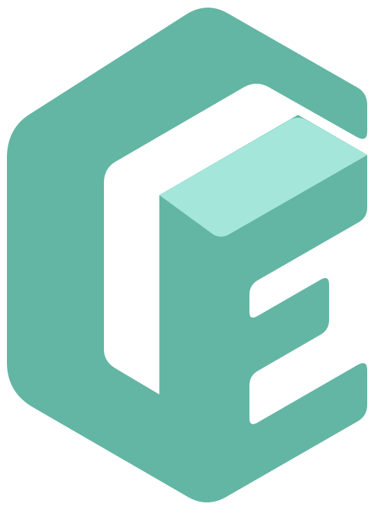

<p align="center">
  
</p>

<h1 align="center">3DCodeFactory — Project Website</h1>

<p align="center"><strong>Scaling Training Data for 3D Code Agents</strong></p>

<p align="center">
  Zhaoyu Wang · Xueru Wen · Xingyu Li · Jie Lou<br />
  <em>Xiaohongshu Inc. · Dots Studio</em>
</p>

<p align="center">
  🌐 <a href="https://3dcodefactory.github.io/"><strong>Live Project Page</strong></a> &nbsp;|&nbsp;
  💻 <a href="https://github.com/3DCodeFactory/3DCodeFactory"><strong>Code &amp; Workflow Repository</strong></a> &nbsp;|&nbsp;
  📑 <a href="https://github.com/3DCodeFactory/3DCodeFactory/blob/main/assets/paper/3DCodeFactory.pdf"><strong>Paper (PDF)</strong></a> &nbsp;|&nbsp;
  🤗 <a href="https://huggingface.co/datasets/wangzhaoyu/3DCodeFactory"><strong>Dataset</strong></a>
</p>

---

This repository hosts the static project website and interactive 3D scene demos served at **[https://3dcodefactory.github.io/](https://3dcodefactory.github.io/)**.

For the **task synthesis, sandboxed rollout, and multi-dimensional rubric verification pipeline (`code3d`)**, prompts, configurations, and documentation, please visit the main code repository:

👉 **[https://github.com/3DCodeFactory/3DCodeFactory](https://github.com/3DCodeFactory/3DCodeFactory)**

## Local Preview

```bash
python3 -m http.server 8768
```

Open `http://localhost:8768` in a browser. All interactive Three.js scenes and video assets use relative paths and require no build step.
